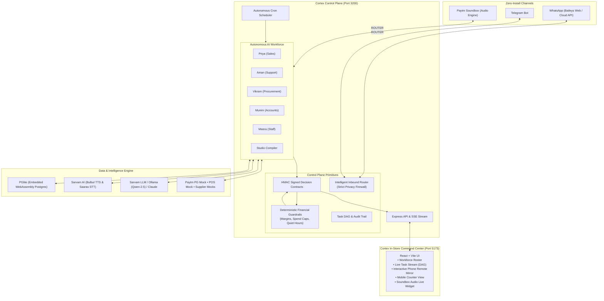

# Cortex ⚡ — The Autonomous AI Back-Office for Bharat MSMEs

> **Paytm Hackathon 2026 — Track 1: Merchant Growth AI**  
> *Turn any counter laptop and Paytm Soundbox into a proactive team of 5 AI employees that sweet shops, kiranas, and restaurants run entirely from WhatsApp.*

[](https://www.typescriptlang.org/)
[](https://vitejs.dev/)
[](https://expressjs.com/)
[-336791.svg?logo=postgresql)](https://electric-sql.com/docs/intro)
[](https://github.com/WhiskeySockets/Baileys)
[](https://paytm.com/)
[-FF6B6B.svg)](https://sarvam.ai/)
[](https://github.com/Hackmaass/PaytmHackathonPune)

---

## 📌 Executive Summary

India has **63 million MSMEs**. In almost every establishment — whether a sweet shop, restaurant, or retail store — the owner is forced to act simultaneously as cashier, accountant, inventory manager, supplier negotiator, and customer dispute resolver. 

Enterprise ERPs (SAP, Salesforce) are far too expensive and complex; typical SaaS tools demand hours of manual data entry. Consequently, small businesses rely on paper registers (*khata*), mental memory, and scattered WhatsApp chats — leading to **invisible stockouts, lost sales, uncollected debts, and high counter friction**.

**Cortex** solves this:
- **Zero New Apps**: The merchant, staff, suppliers, and customers interact only via **WhatsApp / Telegram** and the **Paytm Soundbox**.
- **1-Tap Decisions**: The AI detects problems, negotiates quotes, and reconciles ledgers, presenting the owner with a single 1-tap card: `[✅ Approve]` or `[❌ Reject]`.
- **Authentic Indic Voice Engine**: Powered by **Sarvam AI** (`bulbul:v1` TTS & `saaras:v1` STT) for native Hindi/Hinglish Soundbox edge announcements, WhatsApp audio note transcription, and audio payslips.
- **Zero Cloud Bill & Privacy-First**: Runs locally on the shop laptop using embedded **PGlite** (zero-install WebAssembly Postgres) and supports local edge LLMs (**Ollama `qwen2.5:7b-instruct`** / **Sarvam LLM** / Anthropic).
- **Deterministic Financial Guardrails**: Money never moves via raw LLM hallucination. Strict TypeScript code enforces margins, caps, quiet hours, and signed decision contracts.

---

## 👥 The Autonomous AI Workforce

Cortex deploys a pre-trained, multi-agent AI staff specialized for Indian retail and hospitality operations:

| Agent | Role & Domain | Autonomous Hero Workflow | Impact / Metric |
| :--- | :--- | :--- | :--- |
| 🎯 **Priya** | **Sales & Win-Back Specialist** | 07:00 AM scan detects a -38% dinner sales dip → queries Vikram's stock logs → isolates root cause: *Butter Paneer ran out at 5:45 PM; 28 regulars unserved* → validates gross margin (45% − 10% discount = 35% net margin ≥ 30% floor) → stages 10% voucher campaign → sends 1-tap WhatsApp card to owner → dispatches unique vouchers upon approval → attributes recovered revenue. | **+₹14,800/wk** recovered revenue |
| 🛡️ **Aman** | **Support & Instant UPI Disputes** | Owner sends a 2-second voice note: *"Check ₹350 payment"* → Aman parses Hinglish audio via Sarvam Saaras → queries Paytm PG gateway mock for ₹350 transactions in last 5 mins → checks Soundbox queue telemetry → triggers **Soundbox Edge Override** (*"Paytm par teen sau pachaas rupaye prapt huye"*) if network lagged, or opens dispute ticket `#PTM-44` and sends an instant reassuring WhatsApp slip to customer. | **< 4s** resolution time (down from 5 min) |
| 📦 **Vikram** | **Stock & Procurement Manager** | 06:00 PM stock audit detects Paneer cover < 1 day (12 kg deficit) → automatically sends WhatsApp RFQ to 3 bound dairy suppliers → parses replies into structured quotes (Sharma Dairy: ₹310 vs Gupta: ₹325) → validates price is within 8% guardrail → drafts Purchase Order → sends 1-tap card to owner → dispatches PO to supplier on approval. | **₹4,500/mo** saved; 0 stockouts |
| 📒 **Munim** | **Khata, Accounts & GST Officer** | Daily close reconciles Paytm PG settlements against POS sales (flags ₹620 mismatch) → 11:00 AM Khata routine scans credit overdue > ₹5,000 for 15+ days → filters for quiet hours → drafts polite Hinglish reminders with **Paytm UPI payment links** → generates monthly **GSTR-1** JSON/CSV draft ready for CA review → tracks compliance calendar (GST/FSSAI/Shop Licence). | **+₹25,000** working capital accelerated |
| 👷 **Meera** | **Staff & Payroll Desk** | Staff mark attendance by texting *"Haazir"* or sending voice notes on WhatsApp → Meera compiles shift logs and alerts owner of absentees by 09:15 AM → tracks salary advances and overtime → monthly 1-tap payday triggers net UPI payouts and delivers Hindi audio/visual payslips via Sarvam Bulbul to each worker. | **60+ hrs/mo** owner admin saved |
| ✨ **Studio** | **No-Code Agent Compiler** | Merchant types or speaks a prompt (*"Alert me 48 hours before dairy batches expire"* or *"Clear unsold apparel after 30 days"*) → Studio compiles it into a validated Zod schema with sandboxed tools, cron schedules, and guardrails, hiring a custom agent in 30 seconds. | Infinite custom vertical extensions |

---

## 🏛️ System Architecture



---

## 🛡️ Key Invariants & Architectural Moats

### 1. Deterministic Financial Guardrails ("LLMs Propose, Code Enforces")
LLMs are creative and adaptive, but they must **never** perform financial calculations or auto-authorize payouts.
- Margin floor enforcement: `gross_margin - discount >= 30%`
- Spend caps per agent and per day (e.g. max ₹150 for WhatsApp campaign alerts)
- Anti-spam & quiet hour restrictions (no automated outbound customer messages between 20:00 and 10:00)
- Immutable HMAC-signed decision contracts preventing parameter tampering

### 2. Strict Privacy Firewall
Cortex respects merchant privacy:
- The WhatsApp connector strictly listens **only** to the merchant's authenticated number / self-chat and designated staff members.
- All non-whitelisted group chats, broadcasts, and private messages are immediately dropped before text extraction or storage.

### 3. Local-First & 100% Offline-Safe
- Powered by **PGlite** (embedded Postgres running in-process via WebAssembly). No Docker, no external Postgres service, zero cloud hosting bill.
- Offline and local LLM fallback: seamlessly connects to local **Ollama** (`qwen2.5:7b-instruct`) or **Sarvam LLM**, with built-in heuristic fallbacks if offline.

### 4. Hardware Synergy with Paytm Soundbox & Sarvam Indic Voice Engine
Cortex elevates the Soundbox from a passive payment buzzer into an interactive Indic shop assistant using **Sarvam AI** (`bulbul:v1` TTS & `saaras:v1` STT):
- **Authentic Indic Speech (Sarvam Bulbul)**: Immediate voice announcements in natural Hindi/Hinglish upon 1-tap approvals: *"Paytm par 28 regular customers ko recovery offer bhej diya gaya hai!"*
- **Instant Edge Dispute Override (Aman)**: Spoken confirmation for edge overrides: *"Paytm par teen sau pachaas rupaye prapt huye"*.
- **Inbound WhatsApp Voice Notes (Sarvam Saaras STT)**: The merchant or staff can speak Hindi voice notes on WhatsApp (*"Check ₹350 payment"*, *"Haazir"*), automatically transcribed and routed to the right agent.
- **Audio Payslips for Workers (Meera)**: Dispatches clear Hindi voice payslips directly to workers' WhatsApp.
- **Offline Fallback**: Automatically degrades to local Windows SAPI OS TTS if offline or if API keys are unset.

---

## 📂 Monorepo Structure

```
d:/Projects/PaytmHackathon/cortex/
├── apps/
│   ├── server/               # Express API, SSE stream, WhatsApp/Telegram gateways, scheduler
│   └── web/                  # React + Vite desktop Command Center, Mobile Counter & Remote Mirror
├── packages/
│   ├── db/                   # Drizzle ORM schema + embedded PGlite database
│   ├── shared/               # Zod contracts, API types, shared constants (FE/BE single source)
│   ├── runtime/              # Scheduler, decision signing, guardrails engine, task DAG, cost ledger
│   ├── agents/               # Priya, Aman, Vikram, Munim, Meera & Studio agent implementations
│   ├── channels/             # WhatsApp (Baileys & Cloud API), Telegram, Soundbox & Sarvam voice provider
│   └── connectors/           # Paytm PG mock, POS simulator, supplier quotes mock, GSTR-1 export
└── scripts/
    ├── seed-demo.ts          # Seeds realistic Ramesh Sweets & Restaurant demo state
    ├── verify-api.ts         # Automated runner executing all 24 core API & scenario contracts
    ├── test-voice.ts         # Test suite verifying Sarvam AI TTS/STT and Soundbox audio playback
    └── test-sarvam-llm.ts    # Test suite verifying Sarvam LLM completions
```

---

## 🚀 Quickstart Guide

### Prerequisites
- **Node.js**: `v20.x` or higher
- **pnpm**: `v9.x` or higher (`npm install -g pnpm`)
- *(Optional for cloud Indic voice)*: [Sarvam AI API Key](https://dashboard.sarvam.ai) in `.env`
- *(Optional for local AI)*: [Ollama](https://ollama.ai/) with `ollama run qwen2.5:7b-instruct`

### 1. Installation
Clone the repository and install dependencies:
```bash
git clone https://github.com/Hackmaass/PaytmHackathonPune.git
cd PaytmHackathonPune/cortex
pnpm install
```

### 2. Environment Setup
Copy the example environment file and configure optional keys:
```bash
cp .env.example .env
```
*(Add your `SARVAM_API_KEY` for natural Indic Soundbox audio and voice note transcription).*

### 3. Start Development Servers

#### Option A — 1-Click Launch (Windows):
Double-click [run-cortex.bat](run-cortex.bat) to launch both servers in dedicated windows.

#### Option B — Manual Terminals:

**Terminal 1 — Backend Control Plane & WhatsApp Gateway (Port 3200):**
```bash
cd cortex
pnpm dev:server
```
*(On boot, this automatically seeds the embedded PGlite database, starts the agent scheduler, and displays a WhatsApp pairing QR code).*

**Terminal 2 — Command Center Desktop UI (Port 5173):**
```bash
cd cortex
pnpm dev:web
```
Visit **`http://localhost:5173`** in your browser.

---

## 🧪 Automated Testing & Verification

Cortex features an end-to-end scenario verification suite testing all 24 hero workflows:

```bash
cd cortex
pnpm verify
```

Expected output:
```
==================================================
 CORTEX API & SCENARIO VERIFICATION
==================================================

[1/24] GET /api/cortex/workforce ... PASS
[2/24] GET /api/cortex/stream ... PASS
[3/24] POST /api/cortex/routines/run (07:00 Priya Sales Scan) ... PASS
[4/24] Decision Staged: dec-cmp-44 (VOUCHER_CAMPAIGN) ... PASS
[5/24] POST /api/cortex/decisions/dec-cmp-44/action (Approve) ... PASS
[6/24] Verify Soundbox Announcement Triggered ... PASS
[7/24] Inbound Payment Voice Check ("Check Rs 350") ... PASS
[8/24] Aman Edge Override Dispatched ... PASS
...
[24/24] POST /api/cortex/custom-agents/generate & hire ... PASS

SUMMARY: 24 passed, 0 failed.
STATUS: ALL SYSTEMS GREEN
```

To test the **Sarvam Indic Voice Engine**:
```bash
pnpm test:voice
```

---

## 🎬 Step-by-Step Live Demo Script

Follow this script to experience the 5 hero agent workflows:

### Scenario 1: Priya — 07:00 AM Sales Anomaly & Win-Back Offer
1. On the Command Center dashboard, observe the **Live Task Stream (DAG)**.
2. Click **Run Routine** on Priya's card.
3. Observe Priya detecting the ₹4,800 dinner sales deficit and isolating the root cause (*Butter Paneer stockout*).
4. Review the staged decision card `#CMP-44` with guardrail validation (35% net margin ≥ 30% floor).
5. Click **Approve & Send** on the decision card or tap on the Phone Mirror.
6. The Soundbox announces confirmation: *"Paytm par 28 regular customers ko recovery offer bhej diya gaya hai!"*

### Scenario 2: Aman — Instant UPI Payment & Edge Dispute
1. In the Phone Mirror or WhatsApp, send: *"Check payment ₹350"*.
2. Aman instantly queries Paytm PG mock telemetry and identifies the unannounced transaction.
3. Soundbox immediately plays the audio edge override: *"Paytm par teen sau pachaas rupaye prapt huye"*.
4. Total dispute turnaround: **< 4 seconds**.

### Scenario 3: Vikram — Paneer Cover & Supplier RFQ
1. Click **Stock & Purchase** in the left navigation.
2. Observe Paneer cover marked critical (< 1 day).
3. Click **Request Supplier Quotes** to simulate WhatsApp RFQs sent to Sharma Dairy and Gupta Milk.
4. Compare quotes side-by-side; Vikram recommends Sharma Dairy (₹310/kg vs last price ₹315/kg).
5. Tap **Approve PO** to generate and dispatch the signed purchase order.

### Scenario 4: Munim — Khata Udhaar Recovery & Settlement Reconciliation
1. Navigate to **Khata & Accounts**.
2. Notice 3 overdue customers with balances > ₹5,000 for 15+ days.
3. Click **Stage Khata Reminders** — Munim drafts polite Hinglish reminder templates with Paytm UPI payment links.
4. View the daily settlement audit flagging a ₹620 mismatch between POS cash register and PG settlement.

### Scenario 5: Meera — Staff Attendance & 1-Tap Payday
1. Navigate to **Staff**.
2. Simulate staff checking in by sending *"Haazir"* from worker numbers.
3. Meera updates the live roster and computes net wages after advances.
4. Tap **Approve Payday Payout** to dispatch UPI mock payouts and generate Hindi payslips.

---

## 🏆 Hackathon Alignment — Track 1: Merchant Growth AI

| Criteria | How Cortex Delivers |
| :--- | :--- |
| **"Do More With Less"** | Recovers **₹59,200/mo** in lost sales & accelerates **₹25,000** in overdue udhaar while saving the merchant **60+ hours of admin work monthly**. |
| **Zero Barrier to Adoption** | Runs from the existing shop laptop and WhatsApp; zero training required for non-tech-savvy owners and vernacular workers. |
| **Paytm Strategic Synergy** | Elevates the Paytm Soundbox from a 1-way payment buzzer to an interactive business brain, boosting Paytm UPI volume and underwriting data. |
| **Production-Ready Engineering** | Built with clean domain-driven architecture, deterministic financial guardrails, embedded PGlite database, and comprehensive test coverage. |

---

## 📄 License & Team
Built for the **Paytm AI Hackathon 2026** by **Hackmaass** ([GitHub Repository](https://github.com/Hackmaass/PaytmHackathonPune)).  
All rights reserved.
